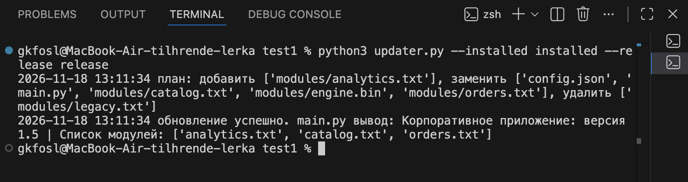
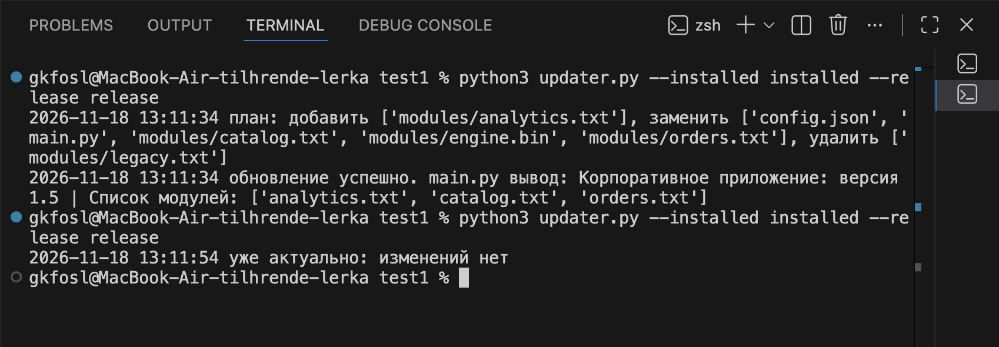
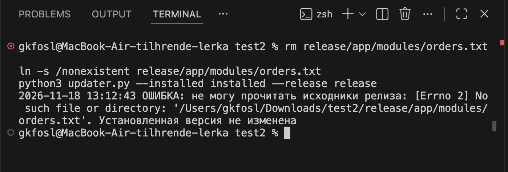
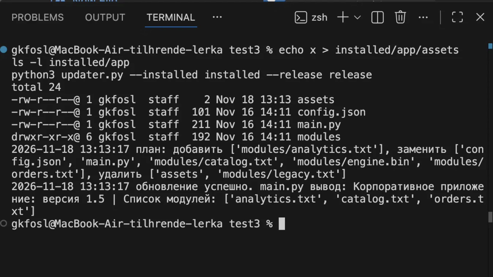
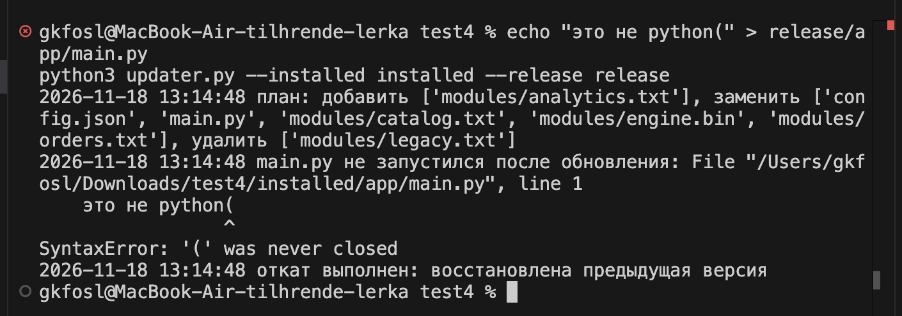

# Заказ 01. Обновлятор корпоративного приложения

Система: macOS 
Обновление: SalesDesk 1.4 → 1.5. Работа ведётся только в копии каталога.

## Как запускать

```
python3 updater.py --installed installed --release release
python3 updater.py --installed installed --rollback
```

## Как устроен обновлятор

1. Сравнивает файлы `installed/app` и `release/app` по SHA-256, а не по размеру или дате (`engine.bin` в обеих версиях 4096 байт, но содержимое разное).
2. Собирает новую версию в отдельной папке `installed/.app_new` и сверяет хеши копии.
3. Двумя переименованиями меняет папки: `app` -> `.app_backup`, `.app_new` -> `app`.
4. Запускает `main.py`. Если он не запустился, автоматически возвращает бэкап.
5. Папки `user_data/` и `logs/` не открывает и не меняет.

## Что изменилось при обновлении

План из лога: добавить `modules/analytics.txt`; заменить `config.json`, `main.py`, `modules/catalog.txt`, `modules/engine.bin`, `modules/orders.txt`; удалить `modules/legacy.txt`.
Вывод `main.py` после обновления: `Корпоративное приложение: версия 1.5`, модули `analytics.txt, catalog.txt, orders.txt`.
`user_data` и `logs` до и после (хеш каталога): совпадают.

## Проверка 1. Запуск второй раз

Команда: обычный запуск повторно.
Результат: «уже актуально: изменений нет», код выхода 0, файлы не перезаписаны.

## Проверка 2. Отсутствует исходный файл

В `release/app/modules/orders.txt` заменён битой ссылкой (`ln -s /nonexistent ...`).
Результат: ошибка «не могу прочитать исходники релиза», код выхода 2. Хеш `installed/app` и `user_data` до и после совпадает: установленная версия не изменена.

## Проверка 3. Файл вместо папки `assets`

Перед запуском создан файл `installed/app/assets` (`echo x > installed/app/assets`).
Результат: обновление успешно, код 0. Файл `assets` как лишний удалён, потому что новая версия собирается заново, а не копируется поверх. `main.py` запускается.

## Проверка 4. Восстановление после сбоя

В `release/app/main.py` записан некорректный код.
Результат: после подмены `main.py` не запустился (`SyntaxError`), выполнен автоматический откат, код выхода 4. Хеш `installed/app` совпадает с исходной версией, в `config.json` версия 1.4.

## Что будет при прерывании копирования

- Обрыв во время копирования в `.app_new`: рабочий `app` не тронут и продолжает работать. Недокопированный `.app_new` удаляется при следующем запуске.
- Обрыв между двумя переименованиями: `app` на мгновение отсутствует, но старая версия целиком лежит в `.app_backup`. Следующий запуск обнаруживает это и возвращает её на место.
- Файл занят запущенной программой (Windows): переименование не выполняется, обновлятор откатывается, версия остаётся старой целиком.
- Если после обновления `main.py` не запускается, откат выполняется автоматически.

## Снимки экрана

### 1. Обычное обновление
Команда запуска, план (добавить / заменить / удалить), «обновление успешно».



### 2. Повторный запуск
«уже актуально: изменений нет».



### 3. Отсутствует исходный файл
Ошибка чтения релиза и сообщение, что установленная версия не изменена.



### 4. Файл вместо папки
Создание файла `assets`, затем успешное обновление.



### 5. Откат после сбоя
Сообщение о неудачном запуске `main.py` и «откат выполнен».



