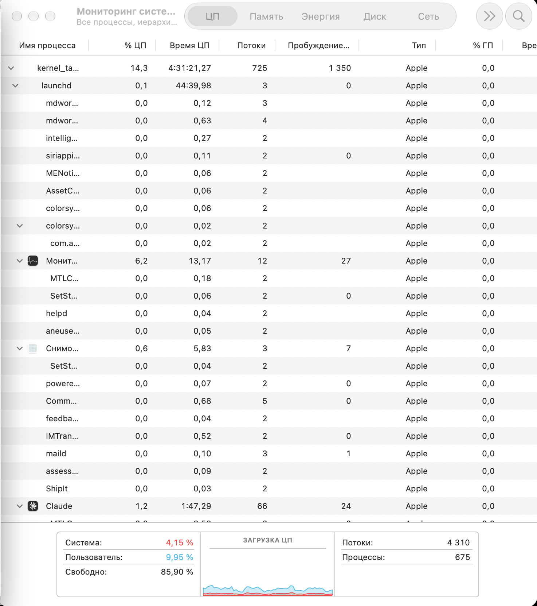
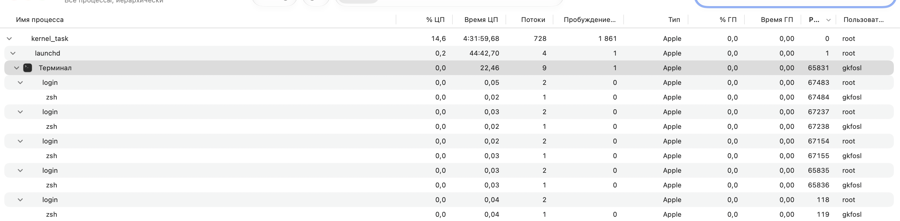
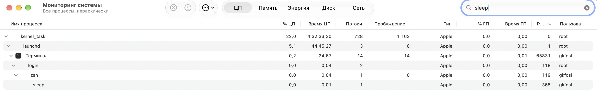
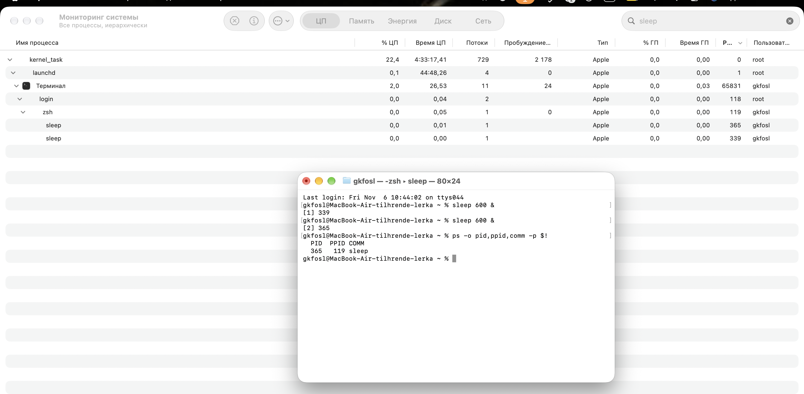
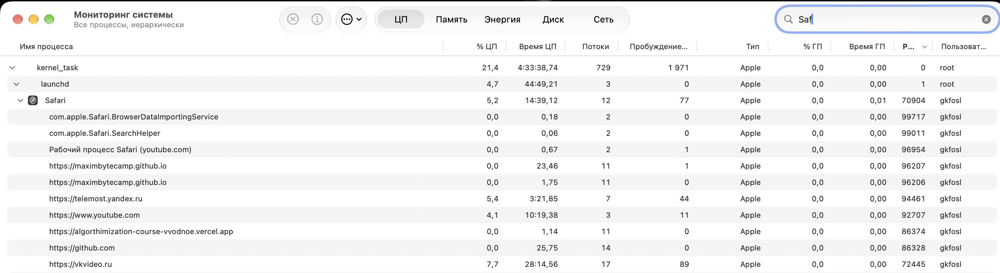
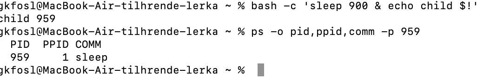
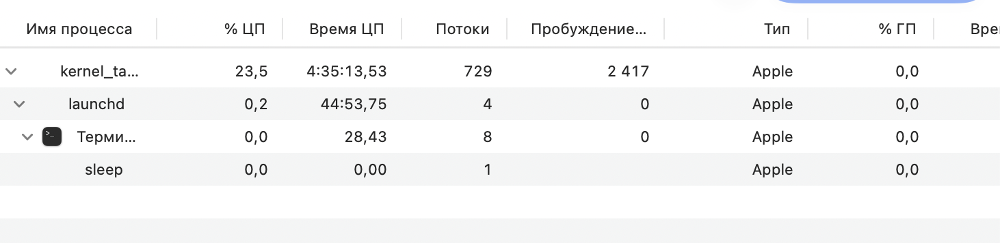

# ЛР 4. Дерево процессов

Система: 
ProductName:		macOS
ProductVersion:		27.0.1
BuildVersion:		26A434

## Дерево
Процесс в начале дерева и его номер: mdworker_shared (99959)
Цепочка родителей терминала (имя и номер): 
zsh	        67484	
login	    67483	
Терминал	65831	
launchd	       1	
kernel_task	   0	
Дочерний процесс: sleep номер 365, родитель zsh 119
Команда, которой проверен родитель:   
PID  PPID COMM
  365   119 sleep
Процессов у браузера и имя процесса вкладок: 10 дочерних процессов

## Сирота
Номер сироты:  959   1 sleep
Номер родителя до и после завершения настоящего родителя: до — 119 (zsh), после — 1 (launchd)
Где сирота стоит в дереве: под terminal

## Снимки экрана

Сохраните снимок поверх заглушки в папке `screenshots/` с тем же именем — ссылки ниже менять не нужно.

### 1. Начало дерева процессов
Шаг 1. Видно: дерево процессов в мониторе: первые процессы системы и их номера.

### 2. Терминал и его родители
Шаг 2. Видно: ветка дерева от процесса терминала вверх до процесса системы.

### 3. Дочерний процесс терминала
Шаг 3. Видно: запущенный из терминала процесс под оболочкой терминала.

### 4. Родитель по команде
Шаг 4. Видно: вывод команды с номером процесса и номером его родителя.

### 5. Процессы браузера
Шаг 5. Видно: раскрытая ветка браузера с дочерними процессами.

### 6. Процесс без родителя
Шаг 6. Видно: команда запуска и номер родителя у оставшегося процесса.

### 7. Сирота в дереве
Шаг 7. Видно: тот же процесс в дереве монитора на новом месте.

