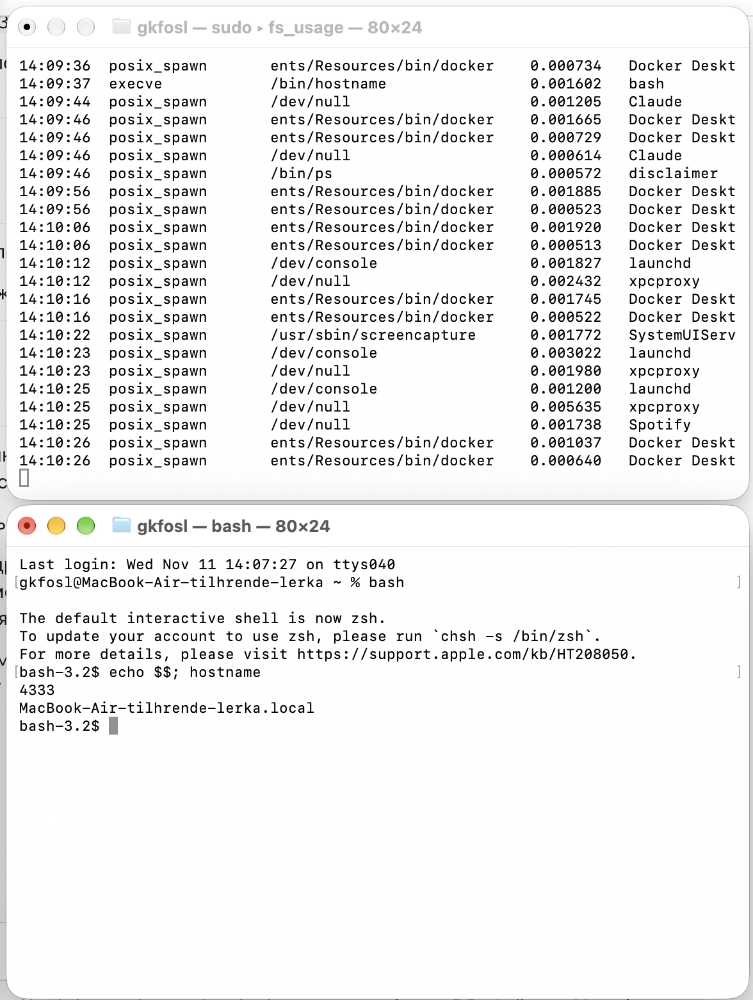
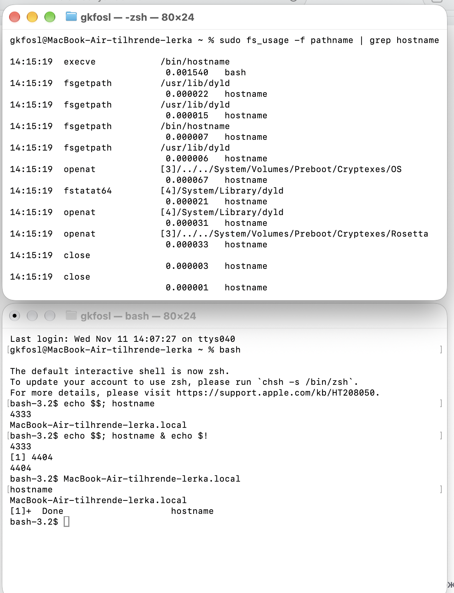
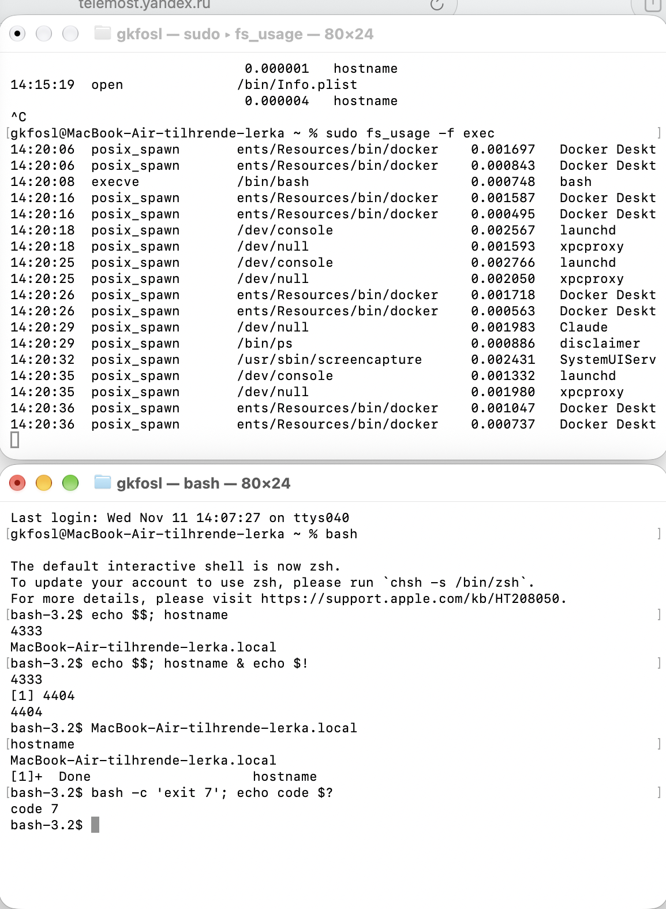
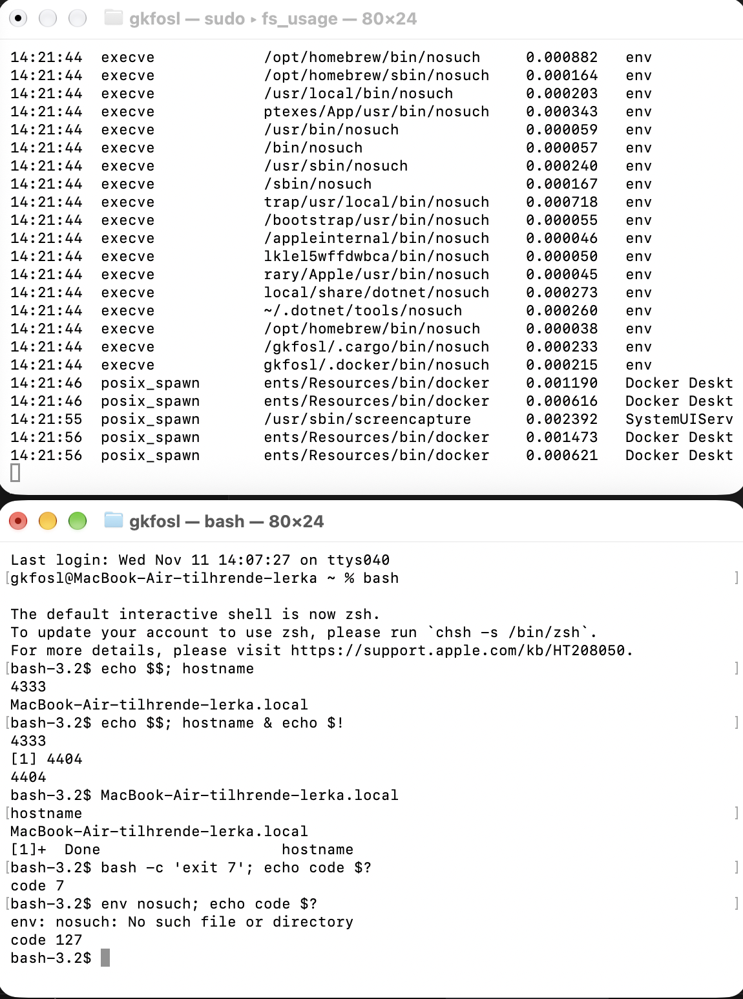
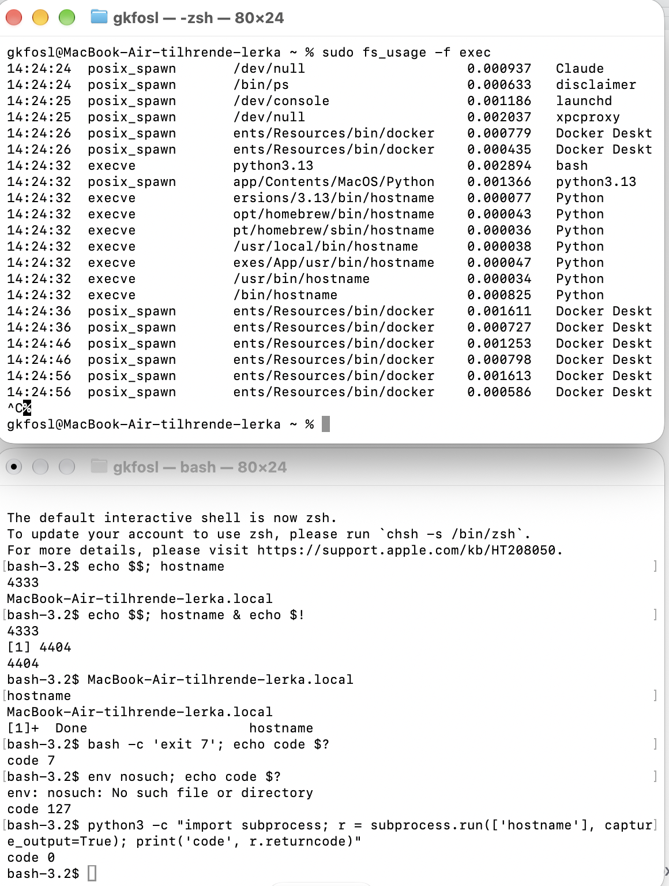

# ЛР 5. Рождение процесса

Система: 
ProductName:		macOS
ProductVersion:		27.0.1
BuildVersion:		26A434
Программа записи: fs_usage

## Рождение
Родитель (имя и номер): bash 4333
Номер нового процесса: 4404
Событие или вызов, которым создан процесс: execve
Библиотек загружено и первая из них: /usr/lib/dyld

## Завершение
Код завершения у ребёнка и у родителя: 7
Программа nosuch: папок проверено 19, ошибка 2, код 127

## Запуск из Python
Номер Python и номер ребёнка: 4743 и 4744
Чем запуск из Python отличается от запуска из оболочки: запускает Python, а не bash

## Снимки экрана

Сохраните снимок поверх заглушки в папке `screenshots/` с тем же именем — ссылки ниже менять не нужно.

### 1. Рождение процесса
Шаг 1. Видно: запись запуска `hostname`: родитель создаёт процесс, у нового процесса номер родителя.

### 2. Библиотеки нового процесса
Шаг 2. Видно: библиотеки, которые загрузил `hostname`, и первая из них.

### 3. Код завершения 7
Шаг 3. Видно: завершение ребёнка с кодом 7 и тот же код у родителя.

### 4. Программы нет
Шаг 4. Видно: поиск `nosuch` по папкам из PATH и ошибка «не найдено».

### 5. Запуск из Python
Шаг 5. Видно: Python создаёт процесс `hostname`: номер Python и номер ребёнка.

