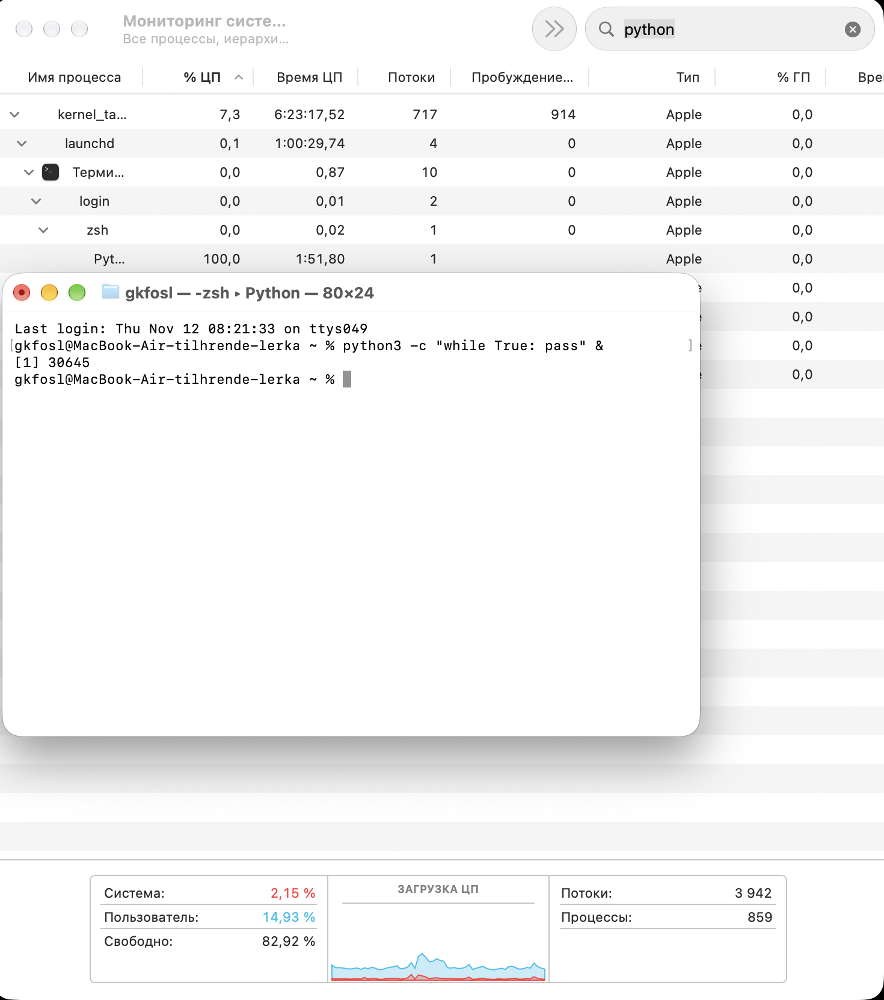
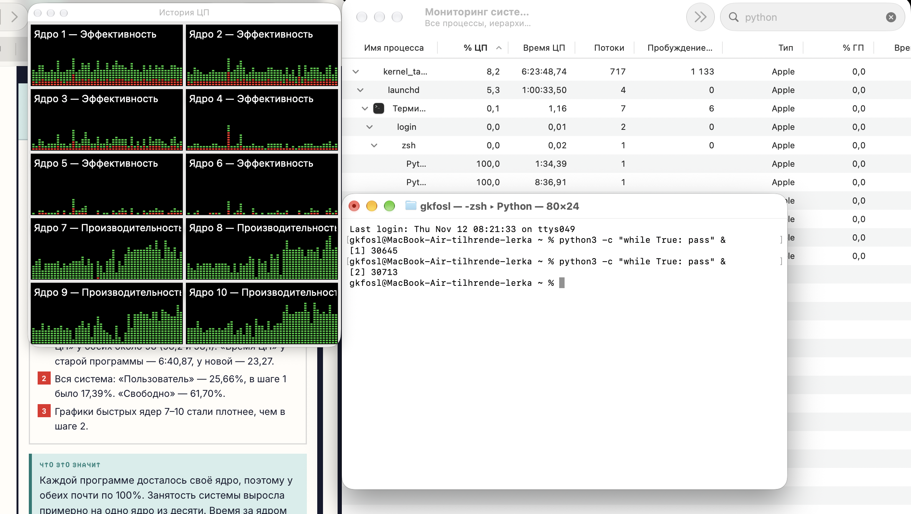
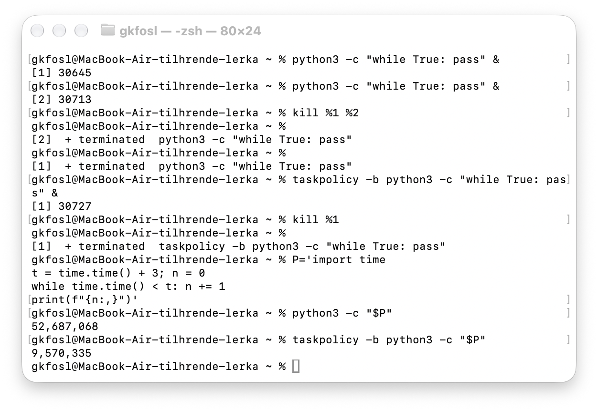
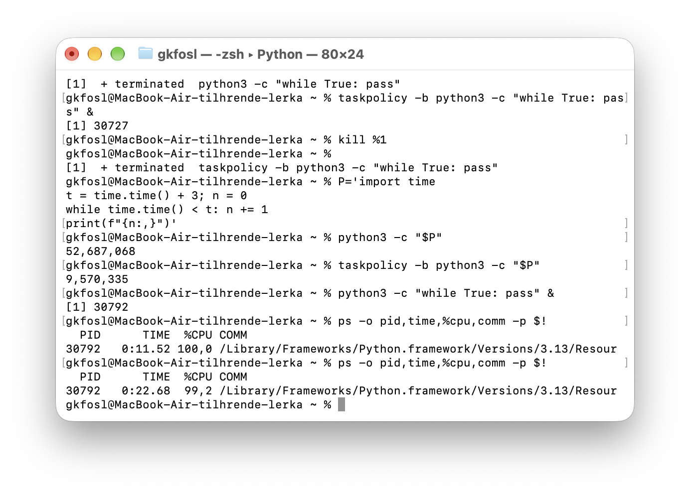

# ЛР 6. Кто загружает процессор

Система: 
ProductName:		macOS
ProductVersion:		27.0.1
BuildVersion:		26A434
Ядер (логических процессоров): 10 (6 эффективных: ядра 1-6, 4 производительных: ядра 7-10)

## Одна нагрузка
Процент процесса в мониторе: 100,0 %
Общая загрузка: система 2,15 %, Пользователь 14,93 %, Свободно 82,92 %
На каких ядрах видна нагрузка: 7-10

## Две нагрузки
Проценты обеих нагрузок и общая загрузка: 100,0 % и 100,0 % (PID 30879 и 30880); Система 3,04 %, Пользователь 26,45 %, Свободно 70,50 %
На одном ядре (в macOS — фоновый режим): 97,8 %; Система 5,96 %, Пользователь 20,53 %, Свободно 73,51 %

## Процессорное время
Первый замер, второй замер, пауза: 0:11.52, затем 0:22.68
Загрузка по замерам: ps показал 100,0 % и 99,2 %; прирост времени 22,68 - 11,52 = 11,16 с
Почему процент в мониторе не говорит о скорости работы: процент показывает, какую долю времени ядро занято, а не сколько работы сделано

## Снимки экрана

Сохраните снимок поверх заглушки в папке `screenshots/` с тем же именем — ссылки ниже менять не нужно.

### 1. Одна нагрузка
Шаг 1. Видно: процесс Python в мониторе: его процент и общая загрузка.

### 2. Две нагрузки
Шаг 3. Видно: два процесса Python и загрузка ядер.

### 3. Нагрузки на одном ядре
Шаг 4. Видно: две нагрузки на одном ядре и их проценты; в macOS — два числа оборотов цикла.

### 4. Процессорное время
Шаг 5. Видно: два замера процессорного времени с паузой между ними.

