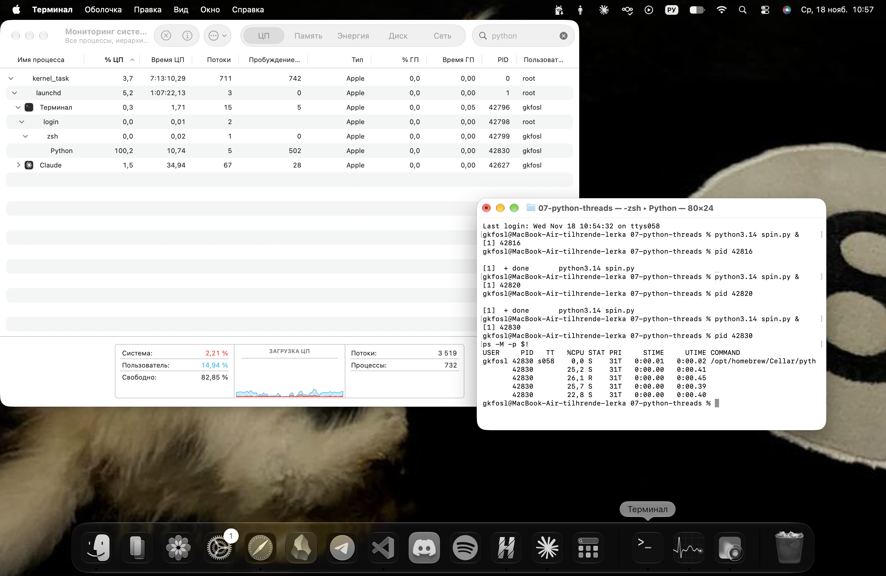
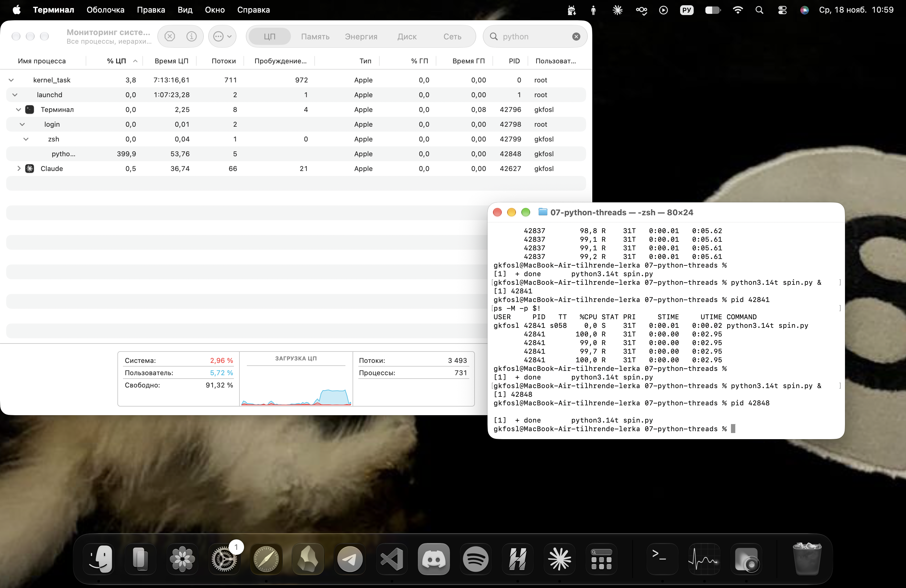
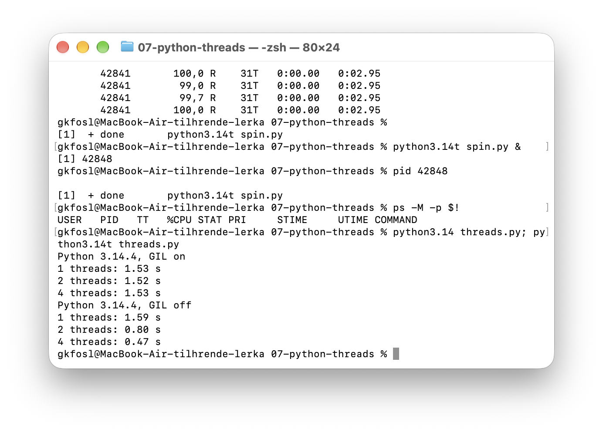

# ЛР 7. Потоки Python и GIL

Система: 
Система: 
ProductName:		macOS
ProductVersion:		27.0.1
BuildVersion:		26A434
Ядер (логических процессоров): 10
Версии Python (обычный и без GIL): Python 3.14.4 (python3.14, GIL включён) и Python 3.14.4 free-threaded (python3.14t, GIL выключен)

## Python с GIL
Процент процесса и число потоков: 100,2 %, 5 потоков (главный + 4 рабочих)
Сколько потоков выполняется одновременно: 1 

## Python без GIL
Процент процесса и проценты потоков: 399,9 %, 5 потоков

## Время работы
С GIL, 1 / 2 / 4 потока: 1,53 с / 1,52 с / 1,53 с
Без GIL, 1 / 2 / 4 потока: 1,59 с / 0,80 с / 0,47 с
Без GIL с PYTHON_GIL=1: 1,60 с / 1,59 с / 1,59 с
Ожидание, 1 и 4 потока: 2,01 с / 2,01 с
Почему ожидающие потоки ускоряются и с GIL: спящему потоку замок не нужен, он не выполняет код Python и отпускает его. Поэтому все 4 потока ждут одновременно: 2,01 с вместо 8 с.

## Снимки экрана

Сохраните снимок поверх заглушки в папке `screenshots/` с тем же именем — ссылки ниже менять не нужно.

### 1. Четыре потока с GIL
Шаг 1. Видно: процесс Python в мониторе: его процент и число потоков.

### 2. Потоки процесса
Шаг 2. Видно: список потоков процесса: сколько выполняется, сколько ждёт.

### 3. Четыре потока без GIL
Шаг 3. Видно: процесс python3.14t в мониторе: его процент.

### 4. Время работы
Шаг 4. Видно: вывод threads.py в Python с GIL и без.

