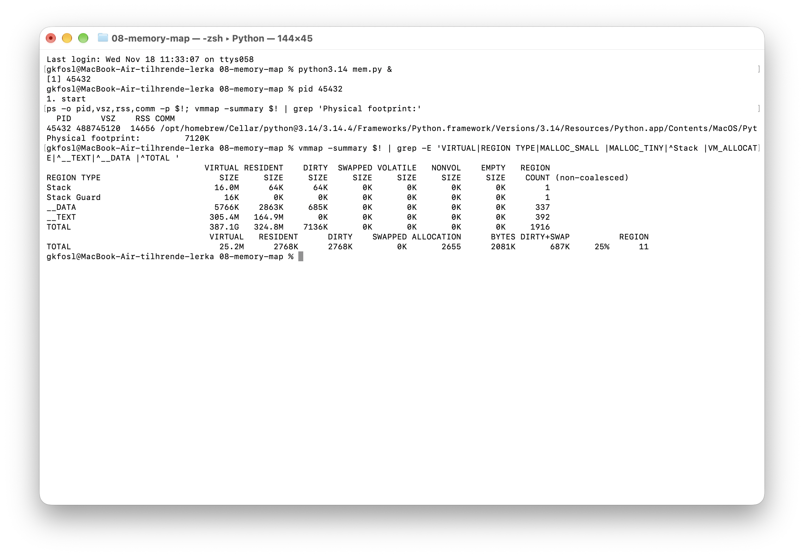
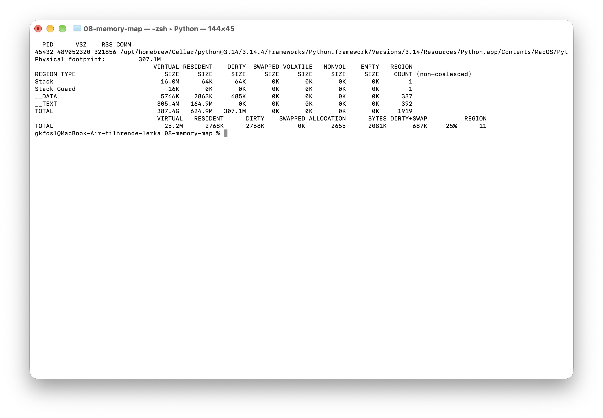
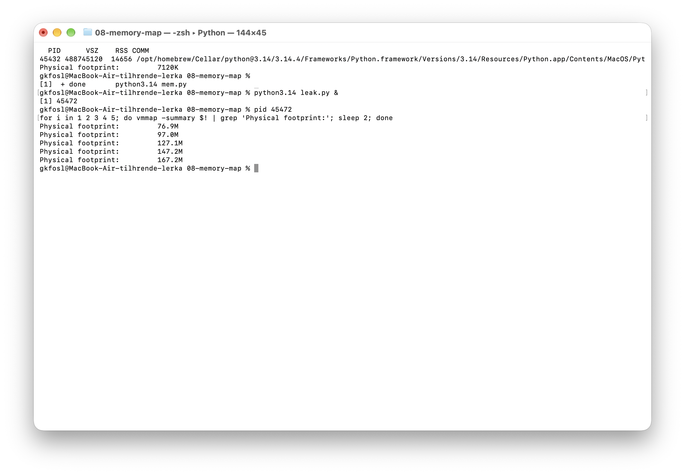

# ЛР 8. Карта памяти

Система:
ProductName:		macOS
ProductVersion:		27.0.1
BuildVersion:		26A434
Чем мерил (виртуальная и занятая): 
- виртуальная: `ps -o vsz` (VSZ, в КБ) и колонка VIRTUAL в `vmmap -summary`
- занятая: `ps -o rss` (RSS, в КБ) и `Physical footprint` из `vmmap -summary`

## Этапы mem.py
Старт: VSZ 488 745 120 КБ, RSS 14 656 КБ (~14 МБ), Physical footprint 7120K (~7 МБ)
Получил 300 МБ: VSZ 489 052 320 КБ (+307 200 КБ = +300 МБ), RSS 14 656 КБ и footprint 7120K не изменились
Записал в каждую страницу: VSZ без изменений (489 052 320 КБ), RSS 321 856 КБ (~314 МБ, +300 МБ), footprint 307.1M, dirty 307.1M
Освободил: VSZ 488 745 120 КБ, RSS 14 656 КБ, footprint 7120K, то есть всё вернулось к значениям на старте
Почему занятая память выросла только на третьем этапе: На втором этапе процесс получил только 300 МБ адресного пространства (виртуальная память выросла), но физических страниц под него ещё нет. Физическая страница выделяется при первом обращении к ней (page fault). Пока программа ничего не писала, RSS и footprint стояли на месте. Когда она записала данные в каждую страницу, ОС выделила реальные страницы, и занятая память выросла на те же 300 МБ.

## Карта памяти
Из каких частей состоит память процесса:
- Stack: стек, 16 МБ виртуально, занято всего 64 КБ.
- Stack Guard: защитная область у стека, 16 КБ, физически не занята (0K).
- __TEXT: код интерпретатора и библиотек, 305 МБ виртуально, 165 МБ резидентно, dirty 0K. Это файловая память, её можно просто выгрузить и перечитать с диска.
- __DATA: данные исполняемого файла и библиотек, ~5.7 МБ виртуально, 2.8 МБ резидентно.

## Утечка
Пять замеров leak.py (Physical footprint): 76.9M -> 97.0M -> 127.1M -> 147.2M -> 167.2M
На сколько росла память за 2 секунды: примерно на 20 МБ (+20.1, +30.1, +20.1, +20.0 МБ)

## Снимки экрана

Сохраните снимок поверх заглушки в папке `screenshots/` с тем же именем — ссылки ниже менять не нужно.

### 1. Карта памяти
Шаг 2. Видно: карта памяти процесса mem.py на старте и её итог.

### 2. Получено 300 МБ
Шаг 3. Видно: виртуальная память выросла на 300 МБ, занятая — нет.

### 3. Страницы заняты
Шаг 4. Видно: занятая память (в macOS — физический след) после записи в каждую страницу.

### 4. Утечка
Шаг 6. Видно: пять замеров памяти leak.py.

