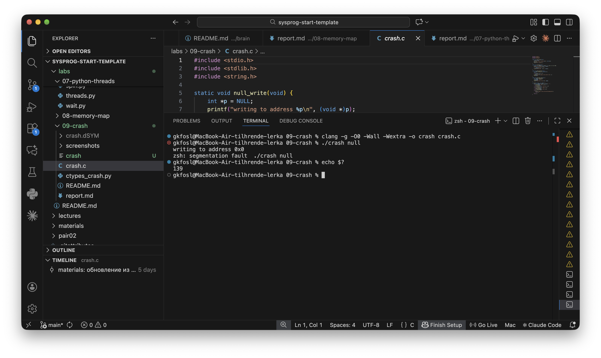
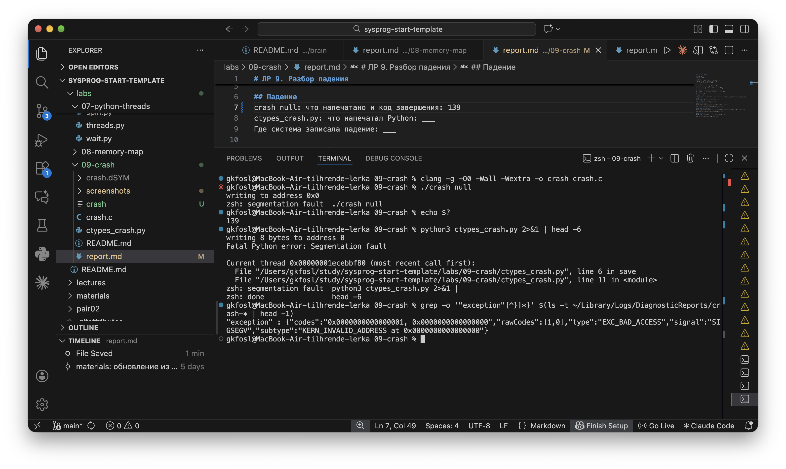
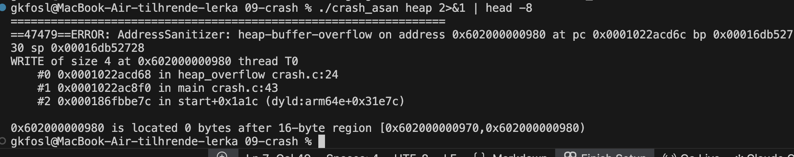
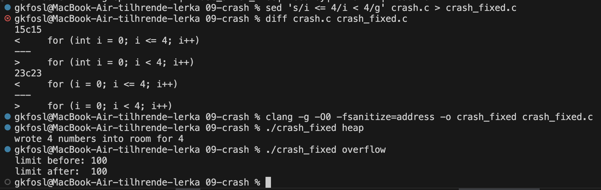

# ЛР 9. Разбор падения

Система: 
ProductName:		macOS
ProductVersion:		27.0.1
BuildVersion:		26A434
Компилятор: 
Apple clang version 21.0.0 (clang-2100.0.123.102)
Target: arm64-apple-darwin27.0.0
Thread model: posix

## Падение
crash null: что напечатано и код завершения: 139
ctypes_crash.py: что напечатал Python: `writing 8 bytes to address 0`, `Fatal Python error: Segmentation fault`
Где система записала падение: `~/Library/Logs/DiagnosticReports/crash-*`

## Молчаливые ошибки
crash overflow: limit до и после, код: limit before: 100, limit after: 7 
crash heap без проверки: `wrote 5 numbers into room for 4`
AddressSanitizer для heap: вид ошибки и строка: `heap-buffer-overflow`, `crash.c:24`
AddressSanitizer для uaf: вид ошибки и две строки: `heap-use-after-free`, `crash.c:33` после , `crash.c:32` 

## Исправление
Что изменено и что напечатала исправленная программа: в циклах `i <= 4` заменено на `i < 4` (строки 15 и 23); `./crash_fixed heap` -> `wrote 4 numbers into room for 4`; `./crash_fixed overflow` -> `limit before: 100`, `limit after:  100`
Не получилось: Мне не вывелся тут код (crash overflow )

## Снимки экрана

Сохраните снимок поверх заглушки в папке `screenshots/` с тем же именем — ссылки ниже менять не нужно.

### 1. Падение
Шаг 1. Видно: запуск crash null и код завершения.

### 2. Падение Python
Шаг 2. Видно: вывод ctypes_crash.py и запись системы о падении.

### 3. Отчёт AddressSanitizer
Шаг 4. Видно: вывод crash heap без проверки и с AddressSanitizer (на Windows с ARM — без проверки).

### 4. Исправление
Шаг 6. Видно: разница файлов и вывод исправленной программы.

